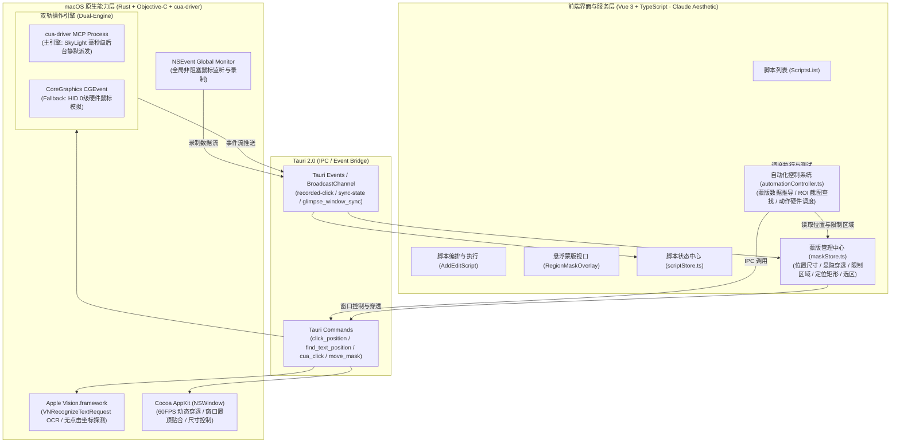

<div align="center">


# Glimpse (灵眸自动化)

**新一代 macOS 原生桌面级自动化脚本工具 · 深度对标自动精灵**

[](https://www.apple.com/macos/)
[-purple)]()
[-orange?logo=tauri&logoColor=white)](https://tauri.app/)
[](https://vuejs.org/)
[](LICENSE)
[](https://github.com/XRSec)

*“低调求发展，潜心习安全” —— 由 [XRSec 团队](https://github.com/XRSec) 匠心打造*

</div>

---

## 📖 项目简介

**Glimpse 灵眸自动化**（App ID: `com.xrsec.glimpse`）是一款专为 macOS 设计的原生、轻量、高性能桌面级自动化脚本编排系统。界面全面汲取 Anthropic Claude 桌面端经典的温润暖炭黑与陶土珊瑚橙调色美学，深度融合 Apple 原生视觉 **Vision.framework OCR** 离线识别引擎、**CoreGraphics** 硬件级键鼠模拟，以及 **60FPS 动态穿透悬浮蒙版**。

无需安装 Python、Tesseract 或庞大的第三方深度学习框架，纯本地毫秒级推理与精准点位执行，为您提供流畅、安全且无阻塞的桌面日常自动化流程体验。

---

## ✨ 核心特性与创新设计

### 1. 🎯 目标应用窗口强制前置绑定与尺寸管理
- **前置依赖强校验**：创建脚本与录制动作前，强制引导绑定目标应用窗口。所有后续点击坐标、OCR 限制区域与全屏录制均在目标应用的专属物理坐标系内完成，未绑定前安全禁用动作添加与录制，从根源杜绝坐标系错位。
- **初次尺寸记忆与启动重置**：初次选取或录制时自动记录目标 App 窗口物理尺寸 `(Width × Height)` 与屏幕坐标 `(X, Y)`。每次启动脚本时自动调用 macOS `AXUIElement` 辅助功能接口将窗口恢复至标定尺寸，彻底消除因窗口缩放导致的点击脱靶。
- **设置卡片三合一融合**：将「基础信息」、「目标应用与窗口尺寸管理」与「全局运行策略」统一收敛进单个高质感卡片，支持展开微调与收起摘要预览。

### 2. 🎯 基准【定位】与单步【测试】的严谨职责分工
Glimpse 彻底理清了自动化脚本编排中“视觉基准确认”与“真实操作执行”的边界，提供分工明确、体验丝滑的双轨调试机制：

- **【定位】(仅感知、画矩形、绝对不点击)**：
  - **核心目的**：用于前序基准确认、限制区域可视化校验与相对坐标推演。
  - **运作逻辑**：自动解析该步骤所依赖的「基准步骤」物理位置（优先读取内存热缓存，无缓存时仅执行离线文字/图形探测）；在桌面透明蒙版上高亮绘制基准步骤的**绿色方框准星**，同时以基准为原点绘制当前步骤对应的**蓝色虚线搜索范围矩形 (`WxH px`)**。
  - **全透明穿透**：定位模式下蒙版强制开启 macOS 全局鼠标穿透（`setIgnoresMouseEvents:YES`），绿色与蓝色标记纯粹作为视觉叠加层，绝不阻断您对底层被控应用进行右键或点击交互。
- **【测试】(单步全链路调试、真执行)**：
  - **核心目的**：单步调试当前动作从“寻找目标”到“执行操作”的完整物理链路。
  - **自遮挡防干扰技术**：执行前**自动毫秒级临时隐藏悬浮蒙版窗口**，彻底杜绝蒙版自身准星、绿框或半透明背景出现在系统截图中污染 OCR 图像识别。
  - **全链路真实派发**：自动唤醒并置顶目标应用窗口；在其限制区域 (ROI) 内执行真实目标查找；识别命中后即刻恢复蒙版并绘制绿色命中方框与蓝色搜索范围；最后**派发真实的硬件级模拟操作（如鼠标点击、输入字符、拖动等）**，直接观察底层应用的实际反馈。
- **⚡ 内存热缓存机制 (`lastBaseMarkerMap`)**：
  - 无论是点击【测试】成功，还是执行【识别】步骤，系统均将命中目标的坐标与物理尺寸实时记入内存字典。
  - 后续步骤在执行或点击【定位】时优先直取内存缓存，**无需重复耗时调用 OCR**；该数据纯内存驻留，不持久化污染脚本 JSON，轻量高效。

### 3. 🔍 独立「识别系列」与无操作纯感知步骤
- **感知与操作彻底解耦**：从菜单体系中彻底移除了传统含混的“AI点击”，重构为与点击系列平级的顶级分类——**「识别系列」**（包含**识别文字**、**识别图片**、**识别颜色**、**识别节点**）。
- **一次识别，多次引用**：允许用户创建专门用于“屏幕感知与位置记录”的无操作步骤。后续多次点击或拖动步骤均可直接将此识别结果作为基准锚点，大幅简化复杂界面的编排步骤。

### 4. 🧩 专职蒙版管理中心 (`maskStore.ts`)
Glimpse 将悬浮蒙版的所有核心能力收敛进统一的 `maskStore` 专用状态与 API 中心，彻底终结了状态分散、方法无序调用的顽疾：
- **位置与尺寸 (Position & Size)**：
  - `bounds` 响应式坐标对象 `(x, y, width, height)`，始终保持屏幕物理点精度。
  - `snapToBounds` / `alignToApp`：支持强力吸附目标 App 物理窗口，或自动贴合被控程序左上角。
  - `setFullscreen`：自动计算并铺满有效工作区屏幕，智能排除 macOS 顶部菜单栏与刘海屏。
  - `syncFromNative`：从 Rust 原生窗口无损双向同步绝对坐标。
- **显隐与穿透仲裁 (Visibility & Passthrough)**：
  - `setVisible(show)`：全局显隐调度，隐藏时**自动原子化清除全部交互残留、历史命中绿框与草稿选区**，保证下次唤醒干干净净。
  - `setSelectingMode(selecting)`：通知 Rust 底层在“全局事件穿透”与“阻断捕获拖拽”之间无缝切换。
  - `hideTemporarilyForAction()` / `restoreVisibility()`：动作执行前自动隐藏蒙版防自遮挡，执行完毕后毫秒级复原。
- **定位矩形与基准标记 (Target Markers & Anchors)**：
  - `runHitAnchor`：运行态与测试命中的**绿色高亮方框与中心十字准星**。
  - `searchROI`：当前步骤限制检索区域的**蓝色虚线搜索框**（附带 `搜索区域 WxH px` 尺寸标签）。
  - `lastBaseMarkerMap`：步骤命中位置的**内存热缓存字典**，实现无冗余的高频多步引用。
- **交互选区驱动 (Interaction Modes)**：
  - `startLimitSelection`：拉拽调整限制区域（珊瑚橙高亮选区框）。
  - `startPointPicking`：实时光标十字准星取点。
  - `startROISelection`：拉拽识别矩形。

### 5. ⚙️ 自动化控制系统 (`automationController.ts`)
专门构建了由数据驱动的视觉检索与动作调度控制中枢，形成清晰的单向流水线：
- **区域推导**：基于 `maskStore` 当前的位置和尺寸，结合当前步骤配置的限制范围 `action.regionScope`（基准步骤偏移或蒙版内缩），精确计算屏幕截图检索区域 (ROI)。
- **视觉检索引擎**：在计算出的限制截图区域内调度原生 Vision OCR、图像模板匹配、颜色容差查找或 Accessibility 节点树遍历。
- **定位与执行策略彻底分离**：
  - **`locateStepTarget`【定位】**：解析基准步骤物理坐标，驱动蒙版同时呈现**基准绿色准星**与**当前步骤蓝色虚线搜索矩形**，**绝对不派发硬件点击**，蒙版全域强制保持鼠标穿透。
  - **`testStepTarget`【测试】**：执行前通过 `maskStore.hideTemporarilyForAction()` 隐藏蒙版防自遮挡，在指定限制区域截图检索，命中后即刻恢复蒙版并绘制绿色命中框与蓝色搜索框，最后**派发真实硬件级操作（左键/双击/右键/拖拽/输入）**，直接驱动被控软件。

### 6. 👁️ Apple 原生 Vision OCR 视觉定位
- **纯本地离线推理**：基于 Apple 原生 `VNRecognizeTextRequest`，无需外接网络接口，零网络传输，数据隐私 100% 本地留存。
- **高精度与模糊匹配**：毫秒级多语言识别（简体中文、繁体中文、英文），支持字词精准比对或子串模糊包含检索。
- **Retina 物理屏幕点位自适应**：智能换算 2x/3x Retina 物理像素与逻辑点位，中心点点击与自定义 X/Y 像素微调校准。

### 7. 🪟 60FPS 动态穿透悬浮蒙版系统
- **双窗口原生架构**：主编辑控制窗口（1080x720）与透明独立置顶蒙版窗口（`NSFloatingWindowLevel`）。
- **原生刘海拖动与多角拉伸**：吸附式刘海无感位移，右下角与四边角无级拉伸，实时同步 CoreGraphics 绝对物理坐标。
- **智能动态穿透机制**：非边框操作区域自动开启 `setIgnoresMouseEvents:YES`，绝不遮挡底层被控软件操作；进入选区或十字拾取时无缝切换为可交互状态。
- **严格生命周期管理**：每次关闭蒙版或切换状态时，自动清理历史交互残留、清空过期命中的绿框脏数据，确保每次唤起蒙版均干干净净。
- **逻辑点对齐无偏移**：窗口定位与吸附全面基于 macOS 逻辑点（Logical Coordinates）换算，彻底解决 Retina 屏幕下多倍坐标换算漂移的历史顽疾。

### 8. 🛡️ 草稿保护与返回未保存拦截
- **脏数据检测 (Dirty Detection)**：进入脚本编排页自动建立初始配置快照，实时追踪任何动作属性变更、蒙版对齐或限制区域调整。
- **返回强拦截确认**：在未点击「保存」按钮前点击返回，系统自动拦截并弹出确认对话框，彻底杜绝误触丢弃或无序自动静默覆盖。

### 9. 🖱️ 拟人化真实键鼠硬件模拟 (cua-driver 驱动集成)
- **跨平台桌面驱动 cua-driver 集成**：Glimpse 深度集成了跨平台桌面自动化驱动 `cua-driver` MCP 服务。作为主操作引擎，cua-driver 基于 macOS SkyLight 私有框架提供后台静默点击能力，实现高达 11ms 极速稳定响应，且具备丰富的坐标执行能力。
- **平滑双轨 Fallback 架构**：若目标应用 `pid` 获取失败或 cua-driver 异常，系统具备毫秒级无感降级能力，自动回退到 Glimpse 原生 Rust `CGEvent` 模拟器。
- **macOS HID 事件流直投**：通过 `CGEvent` 模拟真实硬件中断，支持鼠标**左键单击**、**左键双击**与**原生右键**。
- **破解系统级 Click-Through 吞键**：点击前自动识别并激活目标应用窗口，彻底解决 macOS 后台窗口因焦点激活吞掉首次单击的系统级痛点。
- **丰富移动与滚动轨迹**：支持直线拖动、贝塞尔平滑拟人曲线拖动，以及精准步进的鼠标滚轮平滑滚动。

### 10. 🔴 智能动作录制与右键自适应相对定位
- **系统全局事件非阻塞捕获**：基于 Cocoa `NSEvent addGlobalMonitorForEventsMatchingMask`，录制时用户在目标软件中的正常操作即点即录。
- **右键自适应相对定位**：检测到右键点击时，自动转换为「基于前序步骤的相对偏移」，并自动以基准点为中心创建限定区域（左右±30px、上下±50px），完美适应各位置动态弹出的右键上下文菜单。
- **十字准星靶向拾取**：在动作编辑中点击「🎯 拾取位置/起点/拐点/终点/滚轮」，蒙版自动进入十字准星交互模式，点击即可直接回填相对坐标，支持 `ESC` 一键退出。

### 11. 🎨 Claude App 温润调色美学
- 全站深度采用 Claude 标志性温润暖炭黑背景（`#191716`）、暖灰卡片（`#24211e` / `#262320`）、暖边框（`#383430`）、经典暖陶土/珊瑚橙（`#da7756`）高光点缀与米白文字（`#fbfaf8`），提供极具沉浸感和高级感的工匠级使用体验。

---

## 🛠️ 动作分类体系

Glimpse 提供了完整的动作分类与两级级联编排体系：

| 分类 | 动作类型 | 说明 |
| :--- | :--- | :--- |
| **识别系列** 🔍 | 识别文字 (OCR) | Apple Vision 毫秒级检索文字并记录坐标，**不执行点击**，供后续步骤引用 |
| | 识别图片 | 图像模板相似度匹配定位，**不执行点击**，供后续步骤引用 |
| | 识别颜色 | 特定 HEX 色值与容差区域查找定位，**不执行点击**，供后续步骤引用 |
| | 识别节点 | macOS 原生 Accessibility 辅助功能节点定位，**不执行点击**，供后续步骤引用 |
| **点击系列** 🖱️ | 点击文字 (OCR) | 通过 Apple Vision 毫秒级查找指定文本并派发真实硬件点击 |
| | 点击坐标 | 指定绝对屏幕坐标或相对前序步骤的相对坐标点击 |
| | 点击图片 / 颜色 / 节点 | 辅助模板匹配与视觉锚点触发点击 |
| **拖动系列** ↔️ | 拖动直线 | 从起点 (X1, Y1) 到终点 (X2, Y2) 匀速线性直线拖曳 |
| | 拖动曲线 | 基于起点、贝塞尔拐点、终点的平滑拟人轨迹拖曳 |
| | 鼠标滚动 | 模拟滚轮向上、向下平滑滚动指定步数 |
| **输入系列** ⌨️ | 输入文本 / 粘贴剪贴板 / 清空并输入 | 模拟键盘字符击键与系统剪贴板快速填充 |
| **打开系列** 🚀 | 打开应用 / 打开网址 / 打开文件 | 唤起系统 Application、指定浏览器网页或本地路径 |
| **运行系列** ⚙️ | 运行 Shell / AppleScript | 调用 macOS 本地终端脚本或系统级 AppleScript 自动化 |
| **界面系列** 🖥️ | 等待文字出现 / 消失 / 截图保存 | 界面状态侦测监听与现场画面快照保存 |
| **高级系列** 🧭 | 延时等待 / 条件判断 | 流程控制分支与毫秒级自定义等待 |

---

## 🏗️ 架构概览



---

## 💻 系统环境要求

- **操作系统**：macOS 11.0 (Big Sur) 及以上（完整兼容 macOS 12 Monterey、13 Ventura、14 Sonoma、15 Sequoia 及更高版本）
- **芯片架构**：Universal Binary（原生支持 Apple Silicon M1/M2/M3/M4 系列及 Intel x86_64 处理器）
- **App 标识**：`com.xrsec.glimpse`
- **系统权限**：
  - **辅助功能权限 (Accessibility)**：用于分发原生键盘鼠标模拟事件及系统级全局事件监听。
  - **屏幕录制权限 (Screen Recording)**：用于 Vision OCR 离线截屏分析与局部区域拾取。

---

## 🚀 本地开发与构建

### 1. 前置依赖
- [Bun](https://bun.sh/)（推荐）或 [Node.js](https://nodejs.org/) (>= 18)
- [Rust](https://www.rust-lang.org/) (>= 1.77) 与 `cargo`
- macOS Xcode 或 Command Line Tools (`xcode-select --install`)

### 2. 克隆项目与安装依赖
```bash
# 克隆仓库
git clone https://github.com/XRSec/Glimpse.git
cd Glimpse

# 安装前端依赖
bun install
```

### 3. 启动开发模式
```bash
# 启动 Tauri 桌面热重载开发调试
bun run tauri dev
```

### 4. 构建发布包
```bash
# 构建前端并编译 macOS 原生应用包 (.app / .dmg)
bun run tauri build
```
编译产物将生成在 `src-tauri/target/release/bundle/macos/Glimpse.app`。

---

## 👥 关于团队与致谢

Glimpse 灵眸由 **[XRSec 团队](https://github.com/XRSec)** 独立研发与维护。

- **座右铭**：*“低调求发展，潜心习安全”*
- **组织 GitHub**：[@XRSec](https://github.com/XRSec)
- **开源投屏远控项目**：[Screen-Remote](https://github.com/XRSec/Screen-Remote)
- **核心作者**：星冉 ([Ran Xing](https://github.com/Ran-Xing)) · [Jalapeno1868@outlook.com](mailto:Jalapeno1868@outlook.com)

---

## 📄 开源许可

本项目遵循 [MIT License](LICENSE) 许可协议。
欢迎提交 Issue 与 Pull Request 共同改进！
