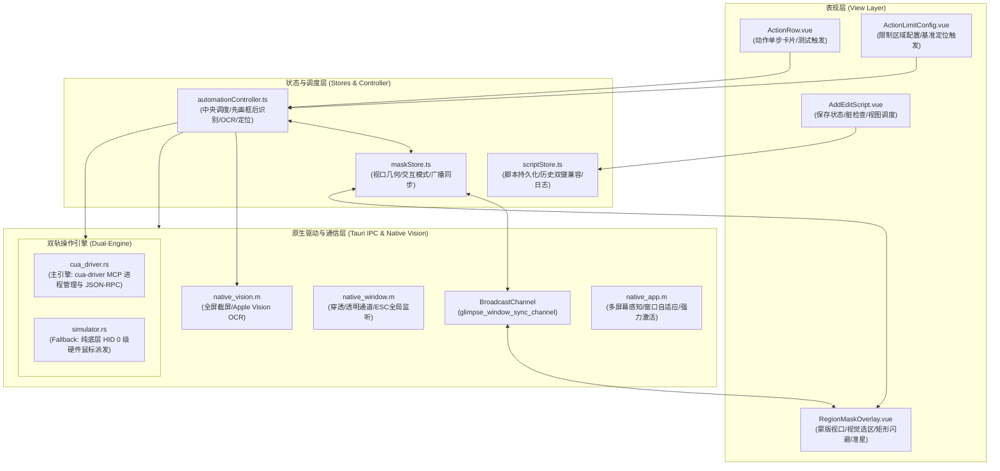
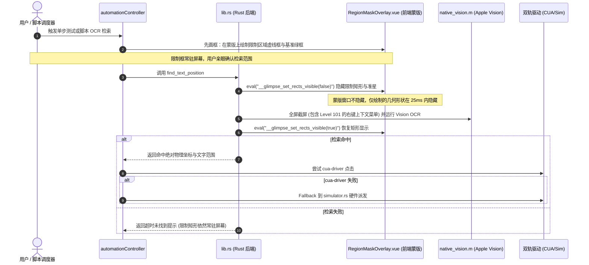

# Glimpse 自动化系统技术规范与架构文档 (System Architecture & Specifications)

本文档系统性沉淀 Glimpse 自动化系统的核心技术架构、数据流向、时序逻辑与 macOS 原生交互避坑准则。

---

## 一、 整体系统分层架构

---

## 二、 关键技术突破与系统核心机制

### 1. 蒙版内部几何图形“毫秒级闪避”机制 (Rectangle Flash-Dodge)
- **痛点与困境**：
  - 蒙版窗口（`mask-overlay`）背景全透明，但其内部绘制的限制区域虚线框（`previewLimitBox`）、基准步骤框（`baseRoiBox`）及命中准星（`runHitAnchorBox`）包含像素填充与边框，在执行截屏时会与屏幕下方的真实文字重叠，严重干扰 Apple Vision OCR 文本识别。
  - 若在截屏时调用 `window.hide()` 隐藏整个蒙版窗口，会导致屏幕明显白闪/抽搐，甚至破坏底层应用的前台焦点。
- **技术实现**：
  - 蒙版窗口全程常驻屏幕，透明度不变，窗口不隐藏；
  - 仅在截屏取样的 25ms 瞬间，通过跨进程调度（Tauri eval `window.__glimpse_set_rects_visible(false)`）让蒙版内部绘制的几何矩形与准星临时隐藏；
  - 原生截屏取样完成后立即恢复（`window.__glimpse_set_rects_visible(true)`）；
  - 人眼无任何感知闪烁，截屏获取到的画面 100% 绝对纯净。

### 2. macOS 窗口层级 (Window Level) 与全局截屏避坑法则
- **陷阱真相**：
  - 过去使用 `pCGWindowListCreateImage(..., kCGWindowListOptionOnScreenBelowWindow, maskWinId, ...)` 试图剔除蒙版窗口自身。
  - macOS 体系中，应用右键上下文菜单（Context Menu / Pop-up Menu）创建于 `NSPopUpMenuWindowLevel`（值为 101），而蒙版悬浮窗口处于 `NSFloatingWindowLevel`（值为 3）。
  - `kCGWindowListOptionOnScreenBelowWindow` 仅包含层级严格低于蒙版的窗口，直接导致飞书右键弹出的上下文菜单（含“撤回”项）被系统在截屏中静默丢弃，OCR 无论如何都无法检测到菜单内容。
- **解决方案**：
  - 结合**矩形毫秒级闪避**，底层截屏全面使用 `kCGWindowListOptionOnScreenOnly`（全屏可见窗口捕获）。
  - 此时无论右键菜单、系统气泡还是对话框，均能 100% 完整清晰捕获。

### 3. macOS 底层 HID 硬件鼠标事件派发准则
- **陷阱真相**：
  - 过去尝试向 `CGEventTapLocation::HID` (0) 与 `CGEventTapLocation::Session` (1) 双重派发，或在点击前后调用 `CGWarpMouseCursorPosition`。
  - 导致飞书瞬间收到两次连续右键点击（菜单“抖了一下就没了”），且光标瞬移容易被系统抑制。
- **解决方案**：
  - 唯一底层硬件派发：仅向 `CGEventTapLocation::HID` 派发携带目标坐标的单次事件流（Down -> Up）。
  - 彻底杜绝 `CGWarpMouseCursorPosition`，保障右键菜单 100% 稳定弹出并常驻。

### 4. 双轨操作引擎架构 (Dual-Engine Fallback)
- **技术选型演进**：
  - 纯 `CGEvent` 模拟器存在需要系统全局辅助功能权限、不同分辨率坐标映射复杂、无法实现后台静默点击等痛点。
  - 为此引入了 `cua-driver` MCP 持久化进程作为主操作引擎。
- **架构实现**：
  - **Rust 侧生命周期托管**：直接在 `src-tauri/src/cua_driver.rs` 内通过 `std::process::Command` 孵化 `cua-driver mcp` 进程，并维护持久化的 JSON-RPC stdio 连接。采用 `tokio::task::spawn_blocking` 避免同步阻塞 Tauri 主线程。
  - **优雅降级 (Fallback)**：动作调度时，若目标应用 `pid` 获取失败或 cua-driver 调用抛出异常，前端会自动在 `catch` 块中拦截，并无缝降级调用原有的原生 `simulator.rs` (CGEvent) 派发，保证点击与拖拽的高可用性。

### 5. 代码文件行数规范（$\le 600$ 行铁律）
- **重构落地**：
  - 原 `native_vision.m`（1106 行）已按职责彻底拆解为 3 个轻量专精模块：
    1. `src-tauri/src/native_vision.m` (226 行)：Vision OCR 文字定位、图像截取与系统权限。
    2. `src-tauri/src/native_window.m` (271 行)：100% 透明通道、60fps 动态穿透计算、鼠标录制与 ESC 监听。
    3. `src-tauri/src/native_app.m` (467 行)：应用感知、跨屏窗口尺寸位置自适应与置顶激活。
  - 后端 `src-tauri/src/lib.rs` 严格精简压缩至 580 行，全员严格达标。

---

## 三、 蒙版矩形闪避调用时序

---

## 四、 跨窗口多端同步通道 (`BroadcastChannel`)

使用通信通道：`glimpse_window_sync_channel`。

| 消息类型 (`type`) | 负载数据 (`payload`) | 业务用途 |
| :--- | :--- | :--- |
| `bounds_updated` | `{ bounds: { x, y, width, height } }` | 蒙版移动或缩放后，向主窗口同步物理坐标 |
| `visibility_updated` | `{ show, isMinimized, isFullscreen }` | 蒙版显隐状态双向广播 |
| `search_roi_updated` | `{ roi: { x, y, width, height, label } }` | 蓝色虚线限制区域矩形实时绘制与更新 |
| `run_hit_anchor_updated` | `{ anchor: { x, y, width, height, stepIndex } }` | 命中点/基准点绿色准星方框实时绘制与更新 |
| `base_marker_updated` | `{ stepIndex, marker }` | 步骤基准坐标缓存跨窗口实时共享 |
| `mask_interaction_start` | `{ context: { mode, baseMarker, ... } }` | 激活框选限制区域、十字准星取点、查看标记等交互状态 |
